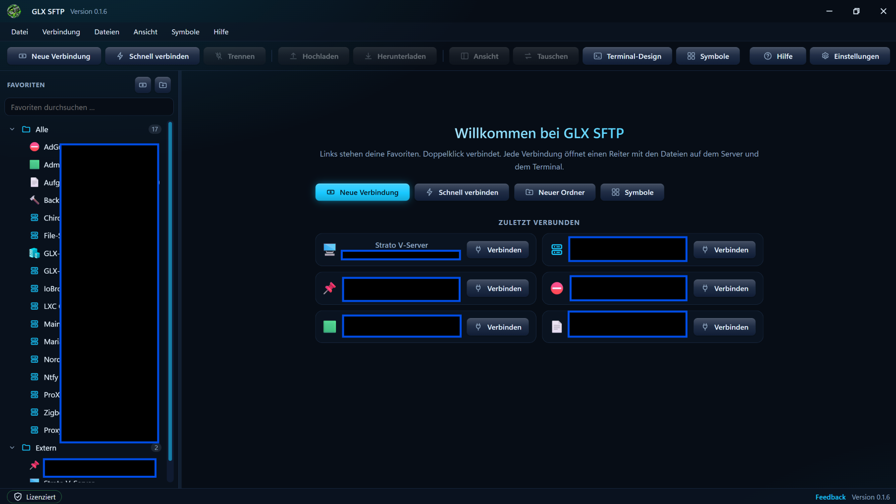
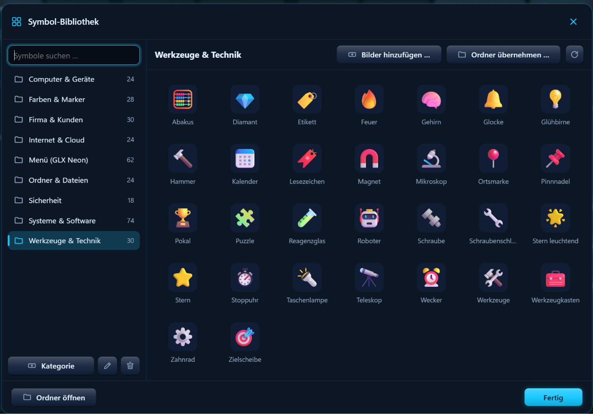

🌍 Sprachen: [🇺🇸 English](README.md) | [🇩🇪 Deutsch](README.de.md)

# 💠 GLX SFTP

### Dein Server-Werkzeug für jeden Tag.

*Dateien, Terminal und deine ganze Serverliste in einem Fenster: SFTP, SSH, FTP und FTPS mit zwei Bereichen nebeneinander.* ⚡

   

---

## ⬇️ Download

👉 Neueste Version: [Releases](../../releases/latest)  
👉 Shop und Lizenzen: [glx-tools.de](https://glx-tools.de/product/glx-sftp-windows/)

---

## 📸 Überblick & Screenshots

### 1️⃣ Startseite mit Favoriten und zuletzt verbunden

### 2️⃣ Terminal-Designs

### 3️⃣ Symbol-Bibliothek für deine Favoriten

### 4️⃣ Integrierte Hilfe

---

## ✨ Funktionen

- 🚀 **Zwei Bereiche, frei wählbar:** Jeder Bereich zeigt PC-Dateien, Server-Dateien oder das SSH-Terminal. Arbeite wie mit einem klassischen FTP-Programm oder wie mit MobaXterm.
- 🧩 **Übertragen per Drag & Drop:** Dateien und Ordner zwischen PC und Server oder aus dem Windows-Explorer ziehen, mit Fortschritt, Tempo, Restzeit und Abbrechen.
- ⚙️ **Sichere Uploads:** Dateien werden zuerst unter einem temporären Namen hochgeladen, so landet nie eine halbe Datei auf dem Server.
- 🔒 **Dateien auf dem Server bearbeiten:** Ein Doppelklick öffnet eine Server-Datei in deinem gewohnten Programm; nach dem Speichern fragt GLX SFTP, ob die Änderung hochgeladen werden soll.
- 📂 **SSH-Terminal mit Designs:** Funktioniert mit nano, htop und mc, Kopieren beim Markieren, Einfügen per Rechtsklick, 12 Farbdesigns, Schrift und Cursor je Server.
- ⚡ **SFTP, SSH, FTP und FTPS:** Explizites und implizites FTPS, Anmeldung mit Passwort oder Schlüssel (PuTTY .ppk und OpenSSH).
- 🎨 **Server übernehmen:** Übernimmt gespeicherte Server aus PuTTY, KiTTY, MobaXterm, WinSCP, FileZilla, Cyberduck und der OpenSSH-Konfiguration, samt Ordnern. Export geht auch.
- 🌍 **Favoriten mit eigenen Symbolen:** Server in Ordnern und Unterordnern, Suche, Sortieren per Ziehen, über 300 Symbole plus eigene Bibliotheken.
- 🛠️ **Von Anfang an sicher:** Passwörter werden für dein Windows-Konto verschlüsselt, Host-Fingerabdruck und FTPS-Zertifikate werden bei jeder Verbindung geprüft.
- 📊 **12 Designs, zwei Sprachen:** Deutsch und Englisch, Hilfe mit Suche, Tooltips an jedem Knopf, Tabs statt zusätzlicher Fenster.

---

## 🧩 Systemanforderungen

- Windows 10 oder Windows 11 (64-Bit)
- Microsoft Edge WebView2 (in aktuellen Windows-Versionen enthalten)

---

## 🧪 Testzeitraum & Lizenz

14 Tage kostenlos mit allen Funktionen. Danach bleiben Favoriten, Symbole und Einstellungen erhalten; Verbindungen und Übertragungen brauchen die Vollversion von [glx-tools.de](https://glx-tools.de).

---

## 🔐 Datenschutz

Passwörter werden verschlüsselt gespeichert und können nur von deinem Windows-Konto gelesen werden. Exporte für andere Programme enthalten nie Passwörter.

---

## 🔗 Mehr zu diesem Produkt

👉 [glx-tools.de](https://glx-tools.de/product/glx-sftp-windows/)  
Support: **info@glx-tools.de**

---

## 📄 Lizenz

Copyright © 2026 GLX Tools – Gordon Lehmann. Alle Rechte vorbehalten.  
Dies ist proprietäre kommerzielle Software. Es wird keine Open-Source-Lizenz gewährt. Dieses Repository enthält nur Release-Downloads und Dokumentation; der Quelltext wird nicht veröffentlicht.

---

Mit ❤️ gemacht von **Dreamdancer100**

