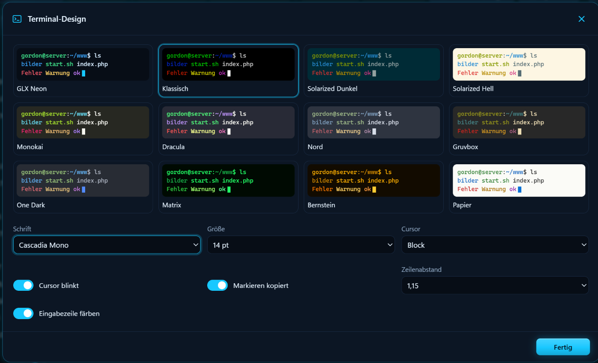
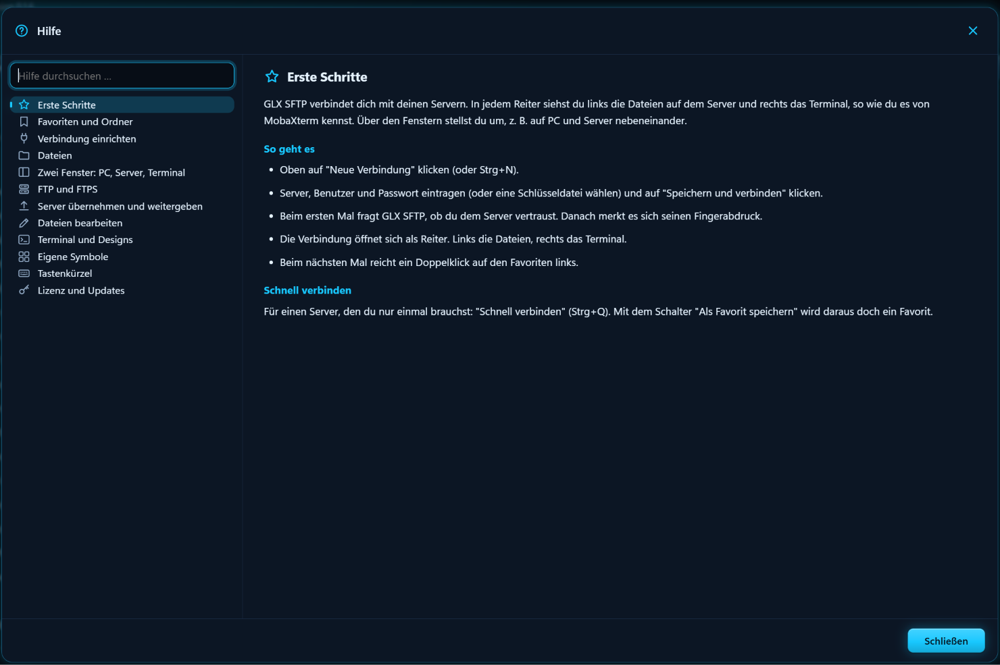

🌍 Sprachen: [🇺🇸 English](README.md) | [🇩🇪 Deutsch](README.de.md)

# 💠 GLX SFTP

### Dein Server-Werkzeug für jeden Tag.

*Dateien, Terminal und deine ganze Serverliste in einem Fenster: SFTP, SSH, FTP und FTPS mit zwei Bereichen nebeneinander.* ⚡

   

---

## ⬇️ Download

👉 Neueste Version: [Releases](../../releases/latest)  
👉 Shop und Lizenzen: [glx-tools.de](https://glx-tools.de/product/glx-sftp-windows/)

---

## 📖 Über GLX SFTP

### Dein Server-Werkzeug für jeden Tag

GLX SFTP ist das Programm für alle, die Webseiten, Heimserver, Proxmox, Raspberry Pi oder gemietete V-Server pflegen. Du verbindest dich per SFTP und SSH, siehst links und rechts genau das, was du gerade brauchst, und hast alle Server übersichtlich in Ordnern links im Blick. Kein Hin- und Herspringen mehr zwischen PuTTY, WinSCP und FileZilla.

### Zwei Fenster, frei wählbar

Jede Verbindung öffnet sich in einem eigenen Reiter. Darin zeigen zwei Fenster nebeneinander wahlweise die Dateien auf deinem PC, die Dateien auf dem Server oder das SSH-Terminal. Umgeschaltet wird mit einem Klick direkt über dem Fenster, ein weiterer Klick tauscht links und rechts.

So arbeitest du wie mit einem klassischen FTP-Programm (PC links, Server rechts) oder wie mit MobaXterm (Server-Dateien und Terminal). Den Trennstrich verschiebst du mit der Maus, die Wahl merkt sich GLX SFTP für die nächsten Verbindungen.

### Dateien einfach hinüberziehen

Dateien und ganze Ordner ziehst du vom PC-Fenster ins Server-Fenster und zurück, auf Wunsch direkt in einen Unterordner. Auch aus dem Windows-Explorer kannst du Dateien hineinziehen. Hochgeladen wird zuerst unter einem Zwischennamen, so liegt nie eine halbe Datei auf dem Server.

Eine Leiste zeigt jede Übertragung mit Fortschritt, Tempo und Restzeit, jede lässt sich abbrechen. Gibt es eine Datei schon, entscheidest du: überschreiben oder überspringen.

### Dateien direkt auf dem Server bearbeiten

Ein Doppelklick öffnet eine Datei vom Server in deinem gewohnten Programm, zum Beispiel einer Konfiguration, einem Skript oder einer HTML-Seite. Nach dem Speichern fragt GLX SFTP, ob die Änderung auf den Server soll. Dazu kommen neue Ordner, Umbenennen, Löschen, Rechte ändern (auch als Zahl wie 644) und das Ein- und Ausblenden versteckter Dateien.

### Terminal mit eigenen Designs

Das SSH-Terminal arbeitet wie gewohnt, auch mit Programmen wie nano, htop oder mc. Markierter Text liegt sofort in der Zwischenablage, ein Rechtsklick fügt ein. Zur Wahl stehen 12 Farb-Designs, Schriftart, Schriftgröße und Cursor. Jeder Server kann sein eigenes Design bekommen, so siehst du sofort, auf welcher Maschine du gerade arbeitest.

### SFTP, SSH, FTP und FTPS

Neben SFTP und SSH beherrscht GLX SFTP auch FTP und FTPS, explizit und implizit über Port 990, etwa für Webspace ohne SSH-Zugang. Anmelden kannst du dich mit Passwort oder Schlüssel (PuTTY .ppk und OpenSSH).

### Alle Server in wenigen Klicks übernehmen

Du musst nichts abtippen. GLX SFTP findet die gespeicherten Server aus PuTTY, KiTTY, MobaXterm, WinSCP, FileZilla, Cyberduck und der OpenSSH-Datei config. Du hakst an, was du übernehmen willst, und die Ordner aus dem alten Programm bleiben erhalten. Exportierte Dateien von einem anderen PC lassen sich ebenso laden.

Umgekehrt speichert GLX SFTP deine Serverliste auch für diese Programme, zum Beispiel für einen Kollegen, der noch PuTTY oder FileZilla nutzt. Passwörter werden dabei nie weitergegeben.

### Favoriten, Ordner und eigene Symbole

Links stehen deine Server, sortiert in Ordnern und beliebig vielen Unterordnern, Reihenfolge per Ziehen mit der Maus. Eine Suche findet jeden Server sofort, ein Doppelklick verbindet.

Jeder Server und jeder Ordner bekommt auf Wunsch ein eigenes Symbol. Über 300 Symbole in Kategorien sind schon dabei, deine eigenen Bilder (PNG, SVG, ICO, JPG und mehr) fügst du in eigenen Bibliotheken hinzu. Sogar die Knöpfe oben in der Leiste kannst du mit eigenen Symbolen versehen.

### Sicher von Anfang an

Passwörter werden verschlüsselt gespeichert, nur dein Windows-Benutzerkonto kann sie lesen. Beim ersten Verbinden zeigt GLX SFTP den Fingerabdruck des Servers und merkt ihn sich. Meldet sich der Server später anders, wird nicht verbunden. Das gilt genauso für die Zertifikate bei FTPS.

### Angenehm zu bedienen

12 Programm-Designs von hell bis dunkel, Deutsch und Englisch, eine ausführliche Hilfe im Programm mit Suche und Tooltips an jedem Knopf. Das Fenster passt sich jeder Größe an, beim Verkleinern rücken die Knöpfe zusammen. GLX SFTP läuft nur einmal, jede weitere Verbindung öffnet sich als Reiter.

### Jetzt 14 Tage testen

Du kannst GLX SFTP 14 Tage lang mit allen Funktionen kostenlos ausprobieren. Danach bleiben deine Favoriten, Symbole und Einstellungen erhalten, zum Verbinden und Übertragen brauchst du die Vollversion. Updates bekommst du direkt im Programm.

---

## 📸 Überblick & Screenshots

### 1️⃣ Startseite mit Favoriten und zuletzt verbunden

### 2️⃣ Terminal-Designs

### 3️⃣ Symbol-Bibliothek für deine Favoriten

### 4️⃣ Integrierte Hilfe

---

## ✨ Funktionen

- 🚀 **Zwei Bereiche, frei wählbar:** Jeder Bereich zeigt PC-Dateien, Server-Dateien oder das SSH-Terminal. Arbeite wie mit einem klassischen FTP-Programm oder wie mit MobaXterm.
- 🧩 **Übertragen per Drag & Drop:** Dateien und Ordner zwischen PC und Server oder aus dem Windows-Explorer ziehen, mit Fortschritt, Tempo, Restzeit und Abbrechen.
- ⚙️ **Sichere Uploads:** Dateien werden zuerst unter einem temporären Namen hochgeladen, so landet nie eine halbe Datei auf dem Server.
- 🔒 **Dateien auf dem Server bearbeiten:** Ein Doppelklick öffnet eine Server-Datei in deinem gewohnten Programm; nach dem Speichern fragt GLX SFTP, ob die Änderung hochgeladen werden soll.
- 📂 **SSH-Terminal mit Designs:** Funktioniert mit nano, htop und mc, Kopieren beim Markieren, Einfügen per Rechtsklick, 12 Farbdesigns, Schrift und Cursor je Server.
- ⚡ **SFTP, SSH, FTP und FTPS:** Explizites und implizites FTPS, Anmeldung mit Passwort oder Schlüssel (PuTTY .ppk und OpenSSH).
- 🎨 **Server übernehmen:** Übernimmt gespeicherte Server aus PuTTY, KiTTY, MobaXterm, WinSCP, FileZilla, Cyberduck und der OpenSSH-Konfiguration, samt Ordnern. Export geht auch.
- 🌍 **Favoriten mit eigenen Symbolen:** Server in Ordnern und Unterordnern, Suche, Sortieren per Ziehen, über 300 Symbole plus eigene Bibliotheken.
- 🛠️ **Von Anfang an sicher:** Passwörter werden für dein Windows-Konto verschlüsselt, Host-Fingerabdruck und FTPS-Zertifikate werden bei jeder Verbindung geprüft.
- 📊 **12 Designs, zwei Sprachen:** Deutsch und Englisch, Hilfe mit Suche, Tooltips an jedem Knopf, Tabs statt zusätzlicher Fenster.

---

## 🧩 Systemanforderungen

- Windows 10 oder Windows 11 (64-Bit)
- Microsoft Edge WebView2 (in aktuellen Windows-Versionen enthalten)

---

## 🧪 Testzeitraum & Lizenz

14 Tage kostenlos mit allen Funktionen. Danach bleiben Favoriten, Symbole und Einstellungen erhalten; Verbindungen und Übertragungen brauchen die Vollversion von [glx-tools.de](https://glx-tools.de).

---

## 🔐 Datenschutz

Passwörter werden verschlüsselt gespeichert und können nur von deinem Windows-Konto gelesen werden. Exporte für andere Programme enthalten nie Passwörter.

---

## 🔗 Mehr zu diesem Produkt

👉 [glx-tools.de](https://glx-tools.de/product/glx-sftp-windows/)  
Support: **info@glx-tools.de**

---

## 📄 Lizenz

Copyright © 2026 GLX Tools – Gordon Lehmann. Alle Rechte vorbehalten.  
Dies ist proprietäre kommerzielle Software. Es wird keine Open-Source-Lizenz gewährt. Dieses Repository enthält nur Release-Downloads und Dokumentation; der Quelltext wird nicht veröffentlicht.

---

Mit ❤️ gemacht von **Dreamdancer100**

