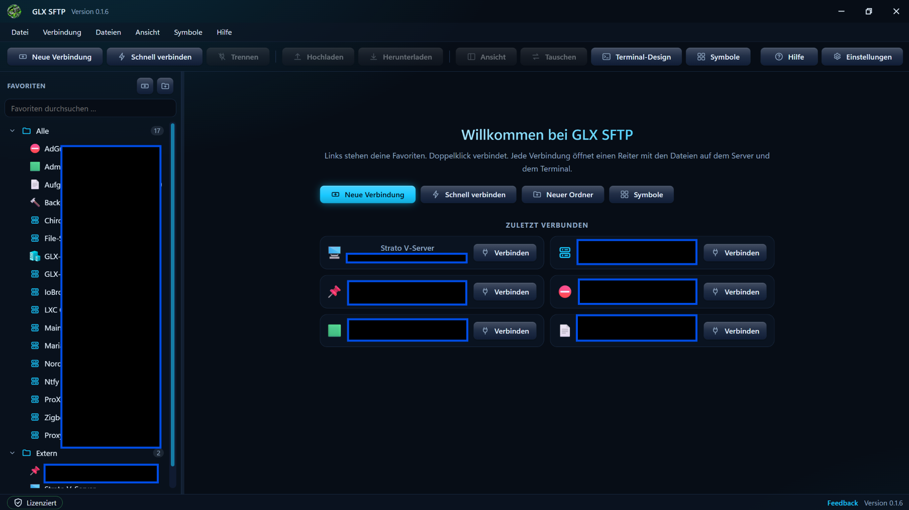
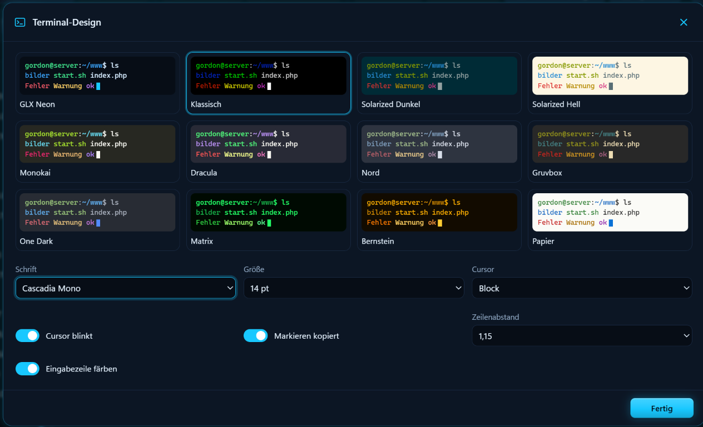
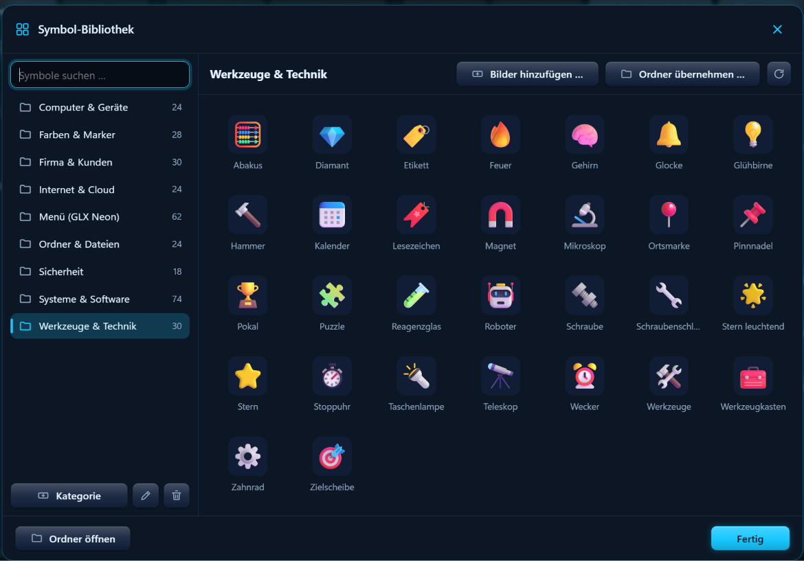
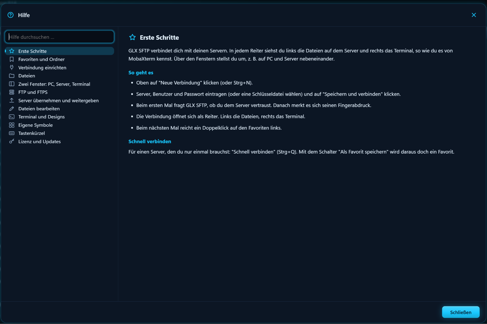

🌍 Languages: [🇺🇸 English](README.md) | [🇩🇪 Deutsch](README.de.md)

# 💠 GLX SFTP

### Your server tool for every day.

*Files, terminal and your whole server list in one window: SFTP, SSH, FTP and FTPS with two panes side by side.* ⚡

   

---

## ⬇️ Download

👉 Latest version: [Releases](../../releases/latest)  
👉 Shop and licences: [glx-tools.de](https://glx-tools.de/product/glx-sftp-windows/)

---

## 📖 About GLX SFTP

### Your server tool for every day

GLX SFTP is made for everyone who looks after websites, home servers, Proxmox, Raspberry Pi or rented virtual servers. You connect via SFTP and SSH, see exactly what you need on the left and right, and keep all servers neatly in folders on the left. No more jumping between PuTTY, WinSCP and FileZilla.

### Two panes, freely selectable

Every connection opens in its own tab. Inside, two panes side by side show either the files on your PC, the files on the server or the SSH terminal. You switch with one click right above the pane, another click swaps left and right.

So you work like with a classic FTP program (PC left, server right) or like with MobaXterm (server files and terminal). Move the divider with the mouse, and GLX SFTP remembers your choice for the next connections.

### Simply drag files across

Drag files and whole folders from the PC pane to the server pane and back, straight into a subfolder if you like. You can also drag files in from Windows Explorer. Uploads go to a temporary name first, so there is never a half file on the server.

A bar shows every transfer with progress, speed and remaining time, and each one can be cancelled. If a file already exists, you decide: overwrite or skip.

### Edit files right on the server

A double-click opens a file from the server in your usual program, for example a configuration, a script or an HTML page. After saving, GLX SFTP asks whether the change should go to the server. Plus new folders, rename, delete, change permissions (also as a number such as 644) and show or hide hidden files.

### Terminal with its own designs

The SSH terminal works as usual, also with programs such as nano, htop or mc. Selected text goes straight to the clipboard, a right-click pastes. Choose from 12 colour designs, font, font size and cursor. Every server can get its own design, so you see at once which machine you are working on.

### SFTP, SSH, FTP and FTPS

Besides SFTP and SSH, GLX SFTP also handles FTP and FTPS, explicit and implicit on port 990, for example for web space without SSH access. Sign in with password or key (PuTTY .ppk and OpenSSH).

### Take over all servers in a few clicks

You do not have to type anything. GLX SFTP finds the saved servers from PuTTY, KiTTY, MobaXterm, WinSCP, FileZilla, Cyberduck and the OpenSSH config file. Tick what you want to take over, and the folders from the old program are kept. Exported files from another PC can be loaded too.

The other way round, GLX SFTP also saves your server list for these programs, for example for a colleague who still uses PuTTY or FileZilla. Passwords are never passed on.

### Favourites, folders and your own icons

Your servers are listed on the left, sorted in folders and any number of subfolders, reordered by dragging. A search finds every server instantly, a double-click connects.

Every server and folder can get its own icon. More than 300 icons in categories are included, and you add your own pictures (PNG, SVG, ICO, JPG and more) in your own libraries. You can even give the buttons in the toolbar your own icons.

### Secure from the start

Passwords are stored encrypted, only your Windows user account can read them. On the first connection GLX SFTP shows the server's fingerprint and remembers it. If the server reports differently later, it does not connect. The same applies to certificates with FTPS.

### Pleasant to use

12 program designs from light to dark, German and English, detailed help in the program with search and tooltips on every button. The window adapts to any size, and the buttons move closer together when it gets smaller. GLX SFTP runs only once, every further connection opens as a tab.

### Try it for 14 days

You can try GLX SFTP free for 14 days with all features. After that your favourites, icons and settings are kept, and connecting and transferring need the full version. Updates come right in the program.

---

## 📸 Overview & Screenshots

### 1️⃣ Start page with favorites and recent connections

### 2️⃣ Terminal designs

### 3️⃣ Symbol library for your favorites

### 4️⃣ Built-in help

---

## ✨ Features

- 🚀 **Two panes, freely chosen:** Each pane shows PC files, server files or the SSH terminal. Work like a classic FTP program or like MobaXterm.
- 🧩 **Drag and drop transfers:** Move files and folders between PC and server or from Windows Explorer, with progress, speed, time left and cancel.
- ⚙️ **Safe uploads:** Files are uploaded under a temporary name first, so a half file never lands on the server.
- 🔒 **Edit files on the server:** Double-click opens a server file in your usual program; after saving, GLX SFTP asks whether to upload the change.
- 📂 **SSH terminal with designs:** Works with nano, htop and mc, copy on select, paste with right-click, 12 colour designs, font and cursor per server.
- ⚡ **SFTP, SSH, FTP and FTPS:** Explicit and implicit FTPS, login with password or key (PuTTY .ppk and OpenSSH).
- 🎨 **Import your servers:** Takes over saved servers from PuTTY, KiTTY, MobaXterm, WinSCP, FileZilla, Cyberduck and OpenSSH config, folders included. Export works too.
- 🌍 **Favourites with own icons:** Servers in folders and subfolders, search, drag to sort, 300+ icons plus your own libraries.
- 🛠️ **Secure from the start:** Passwords encrypted for your Windows account, host fingerprint and FTPS certificates are checked on every connection.
- 📊 **12 designs, two languages:** German and English, help with search, tooltips on every button, tabs instead of extra windows.

---

## 🧩 Requirements

- Windows 10 or Windows 11 (64-bit)
- Microsoft Edge WebView2 (included in current Windows versions)

---

## 🧪 Trial & License

Free with all features for 14 days. After that your favourites, icons and settings are kept; connecting and transferring needs the full version from [glx-tools.de](https://glx-tools.de).

---

## 🔐 Privacy

Passwords are stored encrypted and can only be read by your Windows account. Exports for other programs never contain passwords.

---

## 🔗 More about this product

👉 [glx-tools.de](https://glx-tools.de/product/glx-sftp-windows/)  
For support: **info@glx-tools.de**

---

## 📄 License

Copyright © 2026 GLX Tools – Gordon Lehmann. All rights reserved.  
This is proprietary commercial software. No open-source license is granted. This repository contains release downloads and documentation only; the source code is not published.

---

Made with ❤️ by **Dreamdancer100**

